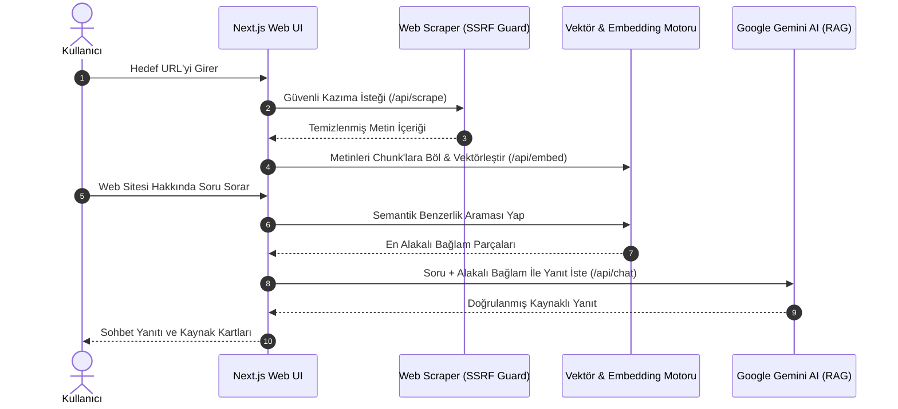

# 🌐 RAG Web Chat - Intelligent Web Scraper & RAG Q&A Platform

[](https://www.typescriptlang.org/)
[](https://nextjs.org/)
[](https://reactjs.org/)
[](https://tailwindcss.com/)
[](https://deepmind.google/technologies/gemini/)
[](https://www.yucelgumus.dev/)

> İstenen herhangi bir web sitesinin içeriğini anında kazıyan (scraping), metinleri anlamsal vektör gömmelerine (embeddings) dönüştüren ve **Retrieval-Augmented Generation (RAG)** mimarisiyle web içeriği üzerinde akıllı soru-cevap sohbeti gerçekleştiren Next.js 15 tabanlı full-stack yapay zeka platformu.

---

## 🌟 Öne Çıkan Özellikler

- 🕷️ **Güvenli Web Kazıma (SSRF-Protected Web Scraping):** İç ağ sızıntılarını ve kötü amaçlı URL yönlendirmelerini engelleyen dahili `SSRF Guard` koruması ile web sitelerinden temiz metin ve yapısal içerik çıkartma.
- 🧠 **Vektörel Arama & RAG Motoru:** Çıkarılan metinleri akıllı parçalara (chunking) bölerek Gemini Embeddings ile indeksler; kullanıcı sorularına en alakalı kaynak paragraflarla bağlamsal yanıtlar üretir.
- 💬 **Canlı Sohbet Arayüzü & Kaynak Gösterimi:** Modelin ürettiği cevapların web sayfasındaki hangi kaynaklardan beslendiğini gösteren referans kartları ve Markdown destekli sohbet ekranı.
- 🏢 **Multi-Tenant & Oturum İzolasyonu:** Farklı kullanıcılar ve oturumlar arasında veri karışmasını engelleyen tenant tabanlı oturum yönetimi (`rag-session.ts`).
- ⚡ **Next.js 15 App Router Mimarisi:** Server Actions, API Route Handlers ve optimize edilmiş istemci bileşenleri ile maksimum hız.

---

## 🏗️ Mimari & Veri Akışı



---

## 🛠️ Teknoloji Yığını

| Kategori | Teknoloji / Kütüphane | Açıklama |
| :--- | :--- | :--- |
| **Framework & Runtime** | Next.js 15 (App Router) + React 19 | Modern full-stack web omurgası |
| **Programlama Dili** | TypeScript (Strict Mode) | Uçtan uca tip güvenliği |
| **Yapay Zeka & LLM** | Google Gemini 1.5 & Text Embeddings | Anlamsal çıkarım ve vektörleştirme |
| **Güvenlik** | Custom SSRF Guard | Dahili IP ve yerel ağ adreslerini engelleme |
| **Stil & Arayüz** | Tailwind CSS & Lucide Icons | Hızlı, erişilebilir ve modern UI bileşenleri |

---

## 🚀 Hızlı Başlangıç

### Gereksinimler
- **Node.js**: v18.18+ veya v20+
- **Google Gemini API Key**: [Google AI Studio](https://aistudio.google.com/)'dan temin edebilirsiniz.

### Kurulum

```bash
# Depoyu klonlayın
git clone https://github.com/yucel-gumus/RAG_Web_Chat.git
cd RAG_Web_Chat

# Bağımlılıkları yükleyin
npm install
```

### Ortam Değişkenleri (`.env.local`)

Proje kök dizininde `.env.local` dosyası oluşturun:

```env
GEMINI_API_KEY=your_gemini_api_key_here
```

### Çalıştırma

```bash
# Geliştirme sunucusunu başlatın
npm run dev
```

Uygulamaya tarayıcınızdan `http://localhost:3000` adresinden erişebilirsiniz.

---

## 📂 Proje Dizin Yapısı

```
RAG_Web_Chat/
├── next.config.ts
├── package.json
├── tailwind.config.ts
└── src/
    ├── app/
    │   ├── layout.tsx
    │   ├── page.tsx                    # Ana web sayfası
    │   └── api/
    │       ├── scrape/route.ts         # SSRF korumalı web kazıma
    │       ├── embed/route.ts          # Vektörleştirme API
    │       ├── chat/route.ts           # RAG sohbet API
    │       ├── documents/route.ts      # Doküman yönetimi
    │       └── session/route.ts        # Oturum yönetimi
    ├── components/
    │   ├── chat/                       # Sohbet bileşenleri (Container, Input, Message)
    │   ├── url-input/                  # URL analiz ve durum giriş çubuğu
    │   └── ui/                         # Kart, Buton, Modal, Input bileşenleri
    └── lib/
        ├── gemini.ts                   # Gemini API istemcisi
        ├── scraper.ts                  # Web içerik ayrıştırıcı
        ├── ssrf-guard.ts               # Güvenlik ve IP filtreleme
        ├── rag-session.ts              # RAG oturum hafızası
        └── tenant.ts                   # Çoklu kiracılık (tenant) yönetimi
```

---

## 📄 Lisans
Bu proje [MIT Lisansı](LICENSE) ile lisanslanmıştır.

---

## 👨‍💻 Geliştirici & İletişim

**Yücel Gümüş** - Full Stack Developer

- 🌐 **Web Sitesi / Portfolyo:** [yucelgumus.dev](https://www.yucelgumus.dev/)
- 💼 **LinkedIn:** [linkedin.com/in/yucel-gumus](https://www.linkedin.com/in/yucel-gumus/)
- 🐙 **GitHub:** [@yucel-gumus](https://github.com/yucel-gumus)

<p align="left">
  <a href="https://www.yucelgumus.dev/" target="_blank" rel="noopener noreferrer">
    
  </a>
</p>
